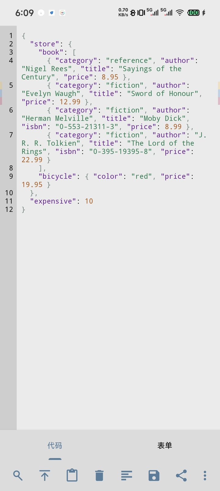
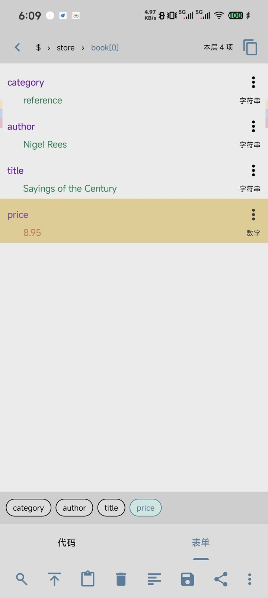
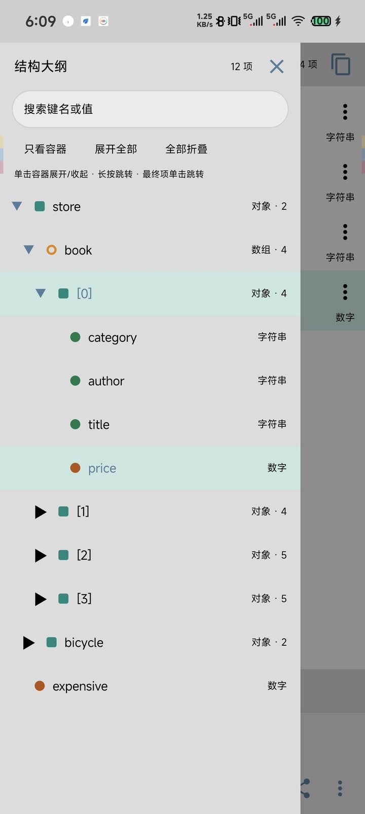
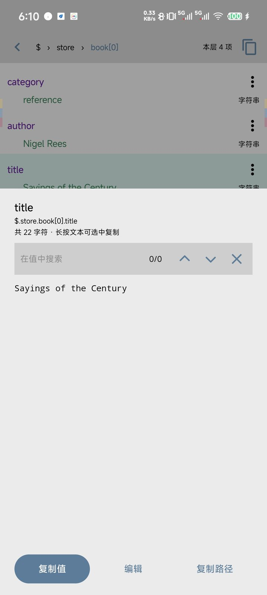
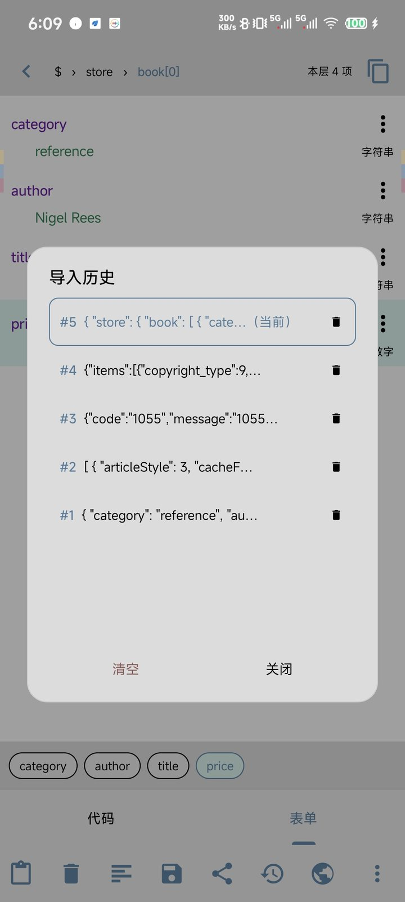
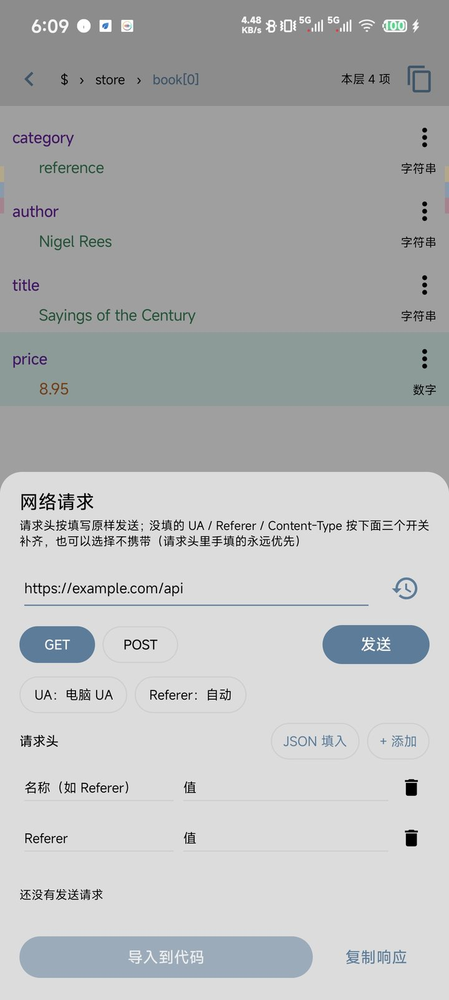
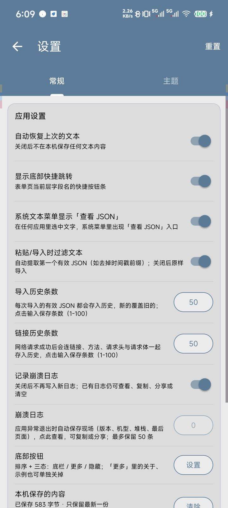
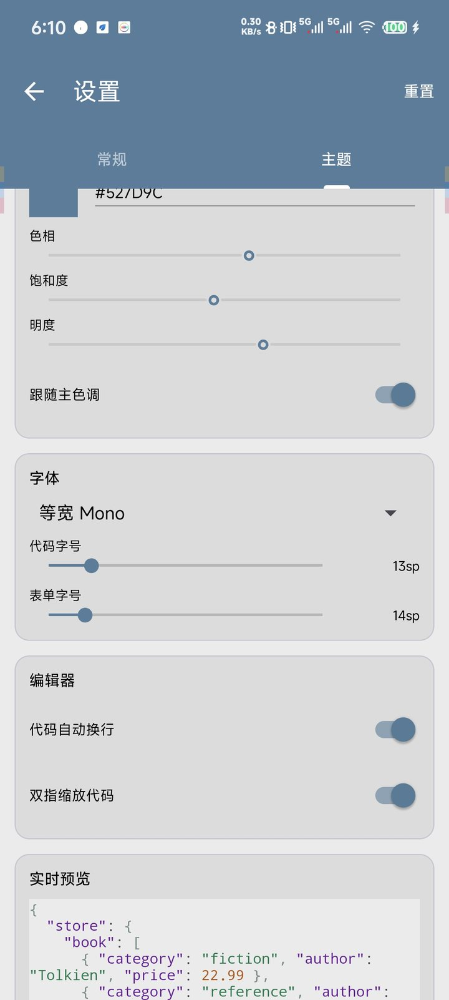

# JSON 查看器 · JSON Viewer

<p align="center">
  
</p>

<p align="center">
  本地优先、最小权限的 Android JSON 查看与编辑工具<br/>
  <sub>View, query and edit JSON on Android — offline by default, one permission only.</sub>
</p>

<p align="center">
  <a href="https://github.com/zmn001125/JsonViewer/releases/latest"></a>
  <a href="https://github.com/zmn001125/JsonViewer/actions/workflows/android.yml"></a>
  <a href="LICENSE"></a>
  
  
</p>

---

## 这是什么

一个装在手机上的 JSON 工作台：粘贴或导入 JSON，在**代码模式**与**表单模式**之间随时切换，查路径、改值、看错误、调接口。解析、着色、搜索、编辑全部在本地完成，没有任何统计、账号或云同步；整个应用只申请 `INTERNET` 一个权限，且仅用于「网络请求」功能。

| 代码模式 | 表单模式 | 结构大纲 | 完整值 / 编辑 |
| :---: | :---: | :---: | :---: |
|  |  |  |  |

| 导入历史 | 网络请求 | 常规设置 | 主题定制 |
| :---: | :---: | :---: | :---: |
|  |  |  |  |

## 功能

### 查看与定位

- **双模式**：代码模式基于自绘编辑器 [Sora Editor](#致谢)，带行号、增量语法高亮、软换行、双指缩放，**几 MB 文本下输入/删除同样跟手**；表单模式**逐层进入**，每次只渲染当前层，节点多也不卡。
- **面包屑导航**：`$ › store › book[2] › title` 每一段可点击回退；右侧显示本层节点数，一键复制当前 JSONPath。
- **结构大纲**：边缘滑动或点按钮呼出，全树展开/折叠、只看容器、按名称或值过滤，点击即跳转并闪烁定位。
- **JSONPath 查询**：支持 `$.a.b`、`$[0]`、`$..x`、`[*]`、切片、过滤表达式；结果可逐条定位或整体复制。
- **双模式搜索**：代码页高亮命中并上下跳转；表单页跨层搜索，命中后自动进入所在层。

### 编辑与转换

- **值详情**：完整内容可滚动、可选中，支持值内搜索、复制值、复制路径。
- **就地编辑**：修改后只替换原文对应片段，代码页与表单页同步；可把值改成字符串 / 数字 / 布尔 / null / 对象 / 数组，保存前按类型校验。
- **大文本编辑**：超过 4 万字符时打开临时代码编辑器（同一套高亮、行号、搜索），直接敲回车即可换行，保存时自动转义为 `\n`。
- **格式化**：一键美化（2 空格缩进）、压缩为单行、中文 ↔ `\uXXXX` 双向转义。

### 网络调试

- GET / POST，请求体原样发送，自定义任意请求头，支持粘贴 JSON 批量填头。
- **一行拆包**：直接粘贴 `https://…,{"method":"POST","body":"a=1","headers":{…},"charset":"gbk"}` 这种抓包格式，自动拆出链接、方法、请求头、请求体与编码；URL 查询参数里的逗号不会被误拆。
- **编码与转义**：文本编码可选 自动 / UTF-8 / GBK / GB18030 / 自定义，同时作用于响应解码、请求体字节和 URL 转义；URL 转义可选 自动（只转中文、空格等，保留已有 `%XX`）、不转义、`%` 也转义。
- **UA 策略**：手机 UA / 电脑 UA / 多条自定义 / 不携带；**Referer** 可关闭自动补全；**Content-Type** 可选自动、JSON、表单、纯文本、自定义或不发送。手填的请求头永远优先。
- 先看状态码与响应体，再决定是否导入到代码页；成功的请求连同方法、头、正文与策略一起进「链接历史」，点一下还原整次请求。

### 个性化与稳定性

- 预设主题 + 自定义主色 / 背景 / 强调色，代码与表单字号独立调节，浅色深色自动适配。
- 底部按钮可排序，每个按钮支持**三态**：底栏 / 更多 / 隐藏；「撤销 / 重做」也在其中，无操作可退时自动压暗。
- 导入历史、链接历史各 1–100 条，可多选删除。
- 崩溃日志默认开启，记录版本、机型、堆栈与崩溃前页面，可在设置里查看、复制、分享或关闭。
- 大文件防护：16MB 文件上限、200 万字符编辑器上限、25 万节点、400 层嵌套、5000 条命中，超限给出明确提示而不是闪退。

## 下载

前往 [**Releases**](https://github.com/zmn001125/JsonViewer/releases/latest) 下载最新 APK：

- `json-viewer-1.5.2.apk` — 正式版，release 签名，可直接安装（Android 7.0+，约 2.5 MB）
- 安装时如提示「未知来源」，在系统设置里允许对应应用安装即可

> 从旧版本（`com.jsonviewer`）升级的用户请注意：包名已改为 `com.guaner.jsonviewer`，新旧版本可以共存，但本地历史与设置不会自动迁移。

## 构建

环境：JDK 17、Android SDK 34（build-tools 34.0.0）、Gradle 8.2（随工程提供 wrapper）。

```bash
git clone https://github.com/zmn001125/JsonViewer.git
cd JsonViewer

./gradlew assembleDebug        # app/build/outputs/apk/debug/app-debug.apk
./gradlew assembleRelease      # app/build/outputs/apk/release/app-release.apk（R8 + 资源压缩）
./gradlew testDebugUnitTest    # 单元测试
```

也可以直接用 Android Studio 打开工程，等待 Sync 完成后运行。

### 签名

仓库**不包含**任何密钥。`assembleRelease` 按以下顺序取签名：

1. 环境变量 `JSONVIEWER_KEYSTORE` / `JSONVIEWER_STORE_PASSWORD` / `JSONVIEWER_KEY_ALIAS` / `JSONVIEWER_KEY_PASSWORD`；
2. 工程根目录的 `release.jks`（已在 `.gitignore` 中排除）；
3. 都没有时退回 debug 签名，保证产物仍可安装。

### GitHub Actions

`.github/workflows/android.yml` 在 push / PR 时运行单元测试并构建 debug 与 release 包，产物上传为 artifact；推送 `v*` 标签时会自动创建 GitHub Release 并附上 APK。

## 工程结构

```
app/src/main/java/com/guaner/jsonviewer/
├── MainActivity.kt              # 主界面：模式切换、解析调度、搜索定位、导入分享
├── JsonViewerApp.kt             # 全局初始化（设置、主题、历史、崩溃日志）
├── json/                        # 解析、建树、序列化、JSONPath、错误定位、限额
├── net/                         # HttpURLConnection 引擎、请求头 JSON 解析
├── data/                        # 设置、导入历史、链接历史、UA 配置、会话存储
├── theme/                       # 主题模型、配色推导、预设与自定义主题
├── editor/                      # 代码编辑器：JSON 增量着色语言、主题→配色映射
├── crash/                       # 崩溃日志落盘与解析
└── ui/                          # 编辑器、树、大纲、值面板、网络面板、设置页
app/src/test/                    # 纯 JVM 单元测试（解析 / 路径 / 序列化 / 设置）
docs/screenshots/                # README 截图
```

技术栈：Kotlin + ViewBinding + Material 3，代码编辑用 [Sora Editor](https://github.com/Rosemoe/sora-editor)，解析用 Jackson Core 流式 API（异常自带字符偏移，便于换算行列），查询用 Jayway JsonPath。没有引入图片加载、数据库或网络库，网络请求直接用 `HttpURLConnection`。

## 权限与隐私

| 权限 | 用途 |
| --- | --- |
| `INTERNET` | 仅「网络请求」面板发起 HTTP/HTTPS 请求 |

- 导入文件走系统文档选择器（SAF），保存与分享走 `FileProvider`，都不需要存储权限。
- 历史、设置、崩溃日志只存在应用私有目录，卸载即清除。
- 无广告、无统计 SDK、无账号体系，不会上传任何内容。

## 说明

- **明文 HTTP**：网络面板允许 `http://`（`network_security_config.xml` 中放开 `cleartextTrafficPermitted`），方便调试内网与老接口；HTTPS 仍走系统 CA 校验。
- **混淆**：release 开启 R8 与资源压缩，json-path / Jackson 已配置 keep 规则。
- **测试**：单元测试覆盖解析器、路径引擎、序列化、限额、设置与主题编解码等纯逻辑模块，不依赖设备与网络。

## 更新日志

- **1.5.2** — 修「大文本下用输入法移动光标非常卡顿、自动换行时更卡、有时按了没反应」。四处各自的根因：① **回给输入法的上下文文本没有上限** —— 输入法每回调一次 `getTextBeforeCursor/AfterCursor` 都要把对应区间跨行拼成一个 String，而 Sora 的 `maxIPCTextLength` 默认是 **50 万**，`getSurroundingText` 更是完全不受这个上限约束（输入法要多少就复制多少，能一路复制到文档末尾）；几十万字符的文档上，一次回调就是几十万字符的拼接，移动一次光标要来好几趟。现在一律封顶 512 字符 —— 输入法只需要光标附近这点上下文做组词联想。这是最大头的一处。② **每次移动光标都走 `setSelection(line, column)`**，而它每次都顺带做三件毫无必要的事：`ensurePositionVisible()` → `getCharLayoutOffset()`（先二分找到这条 line 的某个 row，再沿 rowTable **线性走到目标列**，一行被折成多少段就走多少步，几十万字符的行就是上万步 —— 这正是「开了自动换行更卡」的来源）、把整份渲染缓存作废（下一帧屏上每一行都要重新排版测量，而内容一个字都没变）、重启光标动画。现在改成只做必要的两件事：改光标位置、重绘；目标整条 line 都还在屏幕里时连像素坐标都不算。③ **自动折行有个「文档总长不到 32KB 就跳过」的门槛**，于是一篇 20KB 的压缩 JSON（一行两万字符）从来不会被折短，软换行会把这一行拆成上千个 row，每次移动光标就在里面线性走一遍 —— 门槛去掉。④ **「按了没反应」**：组词标志可能卡在 true —— 百度这类输入法上屏时只调 `commitText`、不调 `finishComposingText`，标志一旦没复位，之后所有左右键都被当成「还在组词」放行给候选区；另外方向键的 **UP 事件**之前会继续往下转发走第二个通道，一次物理按键变成挪两格。现在两处都处理了
- **1.5.1** — 修三处：① **粘贴非 JSON 文本后整篇文字变成白色看不见** —— 这不是着色的问题，是「默认文字样式」用错了颜色槽位：写成了 0，而 `EditorColorScheme` 的槽位从 1 开始，内部 `colors` 是个 `SparseIntArray`，没写过的 key `get()` 返回 0（全透明），字是被透明色画没的。改用真正的 `EditorColorScheme.TEXT_NORMAL`（=5）。受影响的是两条最需要它的路径：JSON 有错时关闭着色，以及超过 4000 列的压缩超长行不着色。② **输入法按左右键移动光标变成了「选中一个字」** —— 百度、搜狗移动光标走的也是 `InputConnection.setSelection(start, end)`，传的是一个**长度恰好为 1 的选区**（`(pos-1, pos)` 表示光标挪到 pos），而 Sora 的实现无条件走 `setSelectionRegion(...)`，于是按一下就选中一个字符；现在把这种形态认出来折叠成光标，真正的选区（选词、拖选）不受影响。③ 顺着折行把剩下的坑填掉：折行只插换行符，**字符偏移却全变了** —— 错误位置、搜索命中、跳转高亮全是偏移，留着就会画到错的地方（「已经改对了，波浪线还挂在别的行」），现在折行后统一作废并触发重算，同时新增 `onTextRearranged` 回调通知上层；折行的安全阀从「折完必须仍是合法 JSON」换成**字符等价校验**（折后文本与原文本逐字符比对，证明只多出了换行符），既不再需要把 500KB 在主线程重新解析一遍，也让**非 JSON 的大段文本同样能折行**（那才是最需要它的时候）；组词期间不折行（否则输入法手里的 composition 会失去依托）；自动折行加了总开关，**值编辑面板强制关闭** —— 那里插入的换行会被当成值的一部分写回 JSON；提示 Toast 只弹一次
- **1.5.0** — 内容解析失败（不是合法 JSON）时，编辑器**彻底关掉语法着色**：错的文本里没有几个有意义的 token，逐行扫描 + 下发几万个 `Span` 全是白做，而「先粘一大段有问题的 JSON、再一点点改对」恰好是最需要跟手的时刻。同一开关也用来控制超长行折行 —— 折行靠引号状态判断「哪些符号在字符串里」，文本本身引号不平衡时这个判断会读错作用域，在**字符串内部**插入真实换行，JSON 字符串不允许裸换行，内容当场报废（也就是反馈里「\n 变成实际换行、再也美化不了」的那次）。现在三道保险：不合法不折行、折完必须仍通过 JSON 校验否则整个放弃、`SafeFolder` 发现一段扫到最后仍处于字符串内就整段原样放行。另外给输入法连接套了一层，显式处理百度/搜狗这类发 `KeyEvent(DPAD_LEFT/RIGHT)` 来移动光标的情况（组词时不截走）
- **1.4.9** — 修复 1.4.8 引入的编辑错乱：删一个字符后「前面的内容不见了、光标错位、一大片文字变成背景色看不见」，以及输入法左右移动光标完全失效。三处根因：① 上版为了省开销把着色改成「只重算受影响行 + `updateStyles` 增量下发」，但 Sora 自己会在每次删除后 `recycle()` 掉被删区间内的 `Span` 对象，这些对象回到对象池又被复用，整张 span 表对不上；现在改回每次编辑下发一份完整的样式表（分词结果仍按行缓存，多余的开销只有组装 span，与行数线性、不做扫描）。② 折行检查挂在「任意编辑」之后，删一个字符也会被判定需要折行 → 整篇替换文本；现在只有**一次插入超过一行**（粘贴/拖入）才检查。③ 之前为了禁联想开了 `props.disallowSuggestions`，而 Sora 拿它当总开关：置 true 后输入法发来的 `setSelection`（＝移动光标）被直接丢弃、`getTextBeforeCursor` 返回空串、`updateSelection` 还回一个随机 index；现在关掉它，改用 `inputType` 上的 `TYPE_TEXT_FLAG_NO_SUGGESTIONS` 抑制联想
- **1.4.8** — 换行慢的根因不在换行算法（一直用的就是 Sora 官方 `setWordwrap`，没有自研），而在**超长单行**：官方 `WordwrapLayout.breakLine` 每找一个断点都要从剩余整行量宽度，单行断行是 O(n²)，50 万字符的压缩 JSON 要算几十亿次字符宽度，打开和打字都会卡死。这版在开启自动换行时，把超长行在**引号之外**的结构符（`,` `{` `[` `:`）之后插入换行压成短行，字符串内部一个字符不动，内容语义不变，之后完全交给官方 `WordwrapLayout`。另外着色改为**增量下发**（`updateStyles` + `SequenceUpdateRange`）：原来每敲一个字都要重建全篇所有行的 span，几万行的文档光这一步就要几十万次分配，现在只重算受影响的那几行，成本与文档规模无关
- **1.4.7** — 大文本自动换行交回 Sora，不再自作主张：删掉「按行长临时开关换行」那套策略。那套策略每次判断都会 `setWordwrap()` 重建布局，Sora 在重建期间把 `layoutBusy` 置位，点击只记坐标不落光标 —— 也就是「正在判断自动换行时完全没法编辑」。现在换行只在换文档/改设置时定一次，输入路径上一次都不碰。另外：压缩成一行的大文本不再逐 token 着色（几千个 span 会让断行和绘制变慢）、分析器不再每次按键都复制整行、字体字号无变化时不再触发整篇重排、语言分析器不再每次按键清掉错误标记
- **1.4.6** — 修复大文本编辑卡顿：粘贴/输入后超长行检测只扫光标前后各 3 行（原来每次编辑都全量扫全文）；文本快照 `toString()` 移到后台线程；开启 `singleDirectionFling` 让横向滑动不再被纵向手势卡住。修复粘贴进来的长文本**不会自动换行**：原来只在 `setText()` 里检测，手动粘贴永远触发不到；换行参数也改回按词边界折行。拖滚动条不再误呼出大纲（滚动条与边缘手势区重叠，按在滚动条上时让路）
- **1.4.5** — 大纲跳转高亮改用**和语法着色/搜索命中同一条样式通道**：由语言分析器在行内下发带背景色的 `Span`（`TextStyle.makeStyle(fg, bg, ...)`），Sora 自己按排版绘制。前两版分别走诊断通道（只画贴基线的细波浪线）和 `onDraw` 手绘坐标（软换行/Tab/比例字体会算歪），都不对
- **1.4.4** — 大纲跳转改为真正的**双层色块**：整行铺满行高铺一条浅色带，字段名压在带上一块深色圆角块。旧版走 Sora 诊断通道，那东西只会画贴近基线的细下划线，看起来几乎没变化；这版两层都改由 `onDraw` 按行高自绘
- **1.4.3** — 修复大纲跳转后字段名没有深色高亮：Sora 的诊断通道对 `SEVERITY_NONE` 直接跳过、且只画波浪线/下划线，画不出背景块，改为在编辑器自绘阶段按 `Layout` 的字符坐标画圆角实色块；整行浅底保留
- **1.4.2** — 底栏新增「撤销 / 重做」，与其他按钮一样可隐藏、可排序，不可用时自动压暗；值编辑弹窗也能搜索/正则/替换；大纲跳转改为「整行浅底 + 字段名实底」双层高亮（不再是波浪线）；设置里的开关按开/关/禁用三态分别配色，关闭态明度明显更低
- **1.4.1** — 代码搜索接入 Sora 的 `EditorSearcher`：支持正则表达式、区分大小写、单个/全部替换，搜索在编辑器内部线程池执行，超大文本也不卡主线程；「设置 → 主题 → 编辑器」新增 4 个搜索相关开关
- **1.4** — 代码编辑改用 Sora Editor：几 MB 文本下打字、删除、滚动全部跟手；代码页、临时编辑器、值编辑框三处统一为同一套编辑器，配色 / 字号 / 字体 / 换行全部跟随主题
- **1.3.1** — 修复「提示已恢复但内容为空」；恢复大文本时不再强制滚动与立即着色
- **1.3** — 优化超大文本的代码编辑手感；新增启动保护：异常退出后本次不再自动恢复上次内容，避免「一打开就崩、进不去」
- **1.2** — 许可证由 MIT 变更为 GNU GPL v3.0：修改或分发须同样开源
- **1.1** — 网络面板支持粘贴「链接,{配置}」自动拆分；新增文本编码（UTF-8 / GBK / GB18030 / 自定义）与 URL 转义三态（自动 / 不转义 / `%` 也转义）
- **1.0** — 首个开源版本

## 致谢

- [Sora Editor](https://github.com/Rosemoe/sora-editor) — 代码编辑器的排版、行号、选区、撤销栈与自绘渲染（LGPL-2.1）
- [Jackson Core](https://github.com/FasterXML/jackson-core) — 流式 JSON 解析
- [Jayway JsonPath](https://github.com/json-path/JsonPath) — JSONPath 查询
- [Material Components for Android](https://github.com/material-components/material-components-android)

## License

[GNU General Public License v3.0](LICENSE) © 2026 zmn001125

这是一份**强 copyleft** 协议，用一句话说清：

| 你的用法 | 是否需要开源 |
| --- | --- |
| 自己用、内部用，不对外分发 | 不需要，随便改 |
| 改了之后分发 APK、上架应用商店、随产品交付给客户 | **必须**以同样协议开放修改后的完整源码 |
| 原样分发（不改） | 需要保留本协议与版权声明，并附带源码获取方式 |

换言之：**可以免费用、免费改、免费商用，但不能拿去做闭源分发。** 分发时需提供对应源码（本仓库地址即可），并保留原作者版权声明。

> **关于历史版本**：v1.0 与 v1.1 曾以 MIT 协议发布，已获得的授权不可撤销，仍按 MIT 处理。GPL-3.0 自 v1.2 起生效。

第三方依赖仍遵循各自协议：Sora Editor（**LGPL-2.1**）、Jackson Core（Apache-2.0）、Jayway JsonPath（Apache-2.0）、AndroidX / Material Components（Apache-2.0），均与 GPL-3.0 兼容。

> **关于 Sora Editor**：它以 LGPL-2.1 发布并以未修改的二进制形式（Maven 依赖）链接进本应用。GPL-3.0 允许这种链接方式；如果你 fork 本仓库并修改了 Sora Editor 自身源码，需要按 LGPL-2.1 开放那部分改动。

